# Dashboard GIS

Dashboard GIS untuk memantau dan mengelola aset jaringan **Tiang** dan **ONT** berbasis peta. Dibangun dengan Laravel & Inertia + React + Leaflet, mendukung manajemen per wilayah, foto aset, dan notifikasi aktivitas.

## Dokumentasi

- [Panduan Penggunaan Aplikasi](docs/panduan-penggunaan-aplikasi.md)
- [Panduan Pengelolaan Data Aset](docs/panduan-pengelolaan-data-aset.md)
- [Panduan Penggunaan Peta Sebaran Aset](docs/panduan-peta-sebaran-aset.md)
- [Panduan Pengaturan Wilayah Operasi](docs/panduan-wilayah-operasi.md)
- [Panduan Notifikasi dan Rekapitulasi](docs/panduan-notifikasi-rekapitulasi.md)
- [Dokumentasi Teknis Sistem](docs/dokumentasi-teknis-sistem.md)

## Panduan Docker (Disarankan)

### Prasyarat

- **Docker Engine** 24+ dan **Docker Compose** v2 (`docker compose`)
- **Git**

### Quick Start

```bash
git clone https://github.com/Magang-VAS/dashboard-gis.git
cd dashboard-gis
cp .env.example .env
docker compose up -d --build
```

Compose membangun image, membuat `APP_KEY` jika belum ada, menunggu MySQL siap, menjalankan migrasi, membuat storage link, lalu menjalankan aplikasi.

- Aplikasi: `http://localhost:8090`
- phpMyAdmin: `http://localhost:8091` (server `mysql`, user `laravel`, password `laravel`, database `gis_database`)
- MySQL: host port `3307`, container port `3306`

Port dapat diubah melalui `APP_PORT`, `PHPMYADMIN_PORT`, dan `MYSQL_PORT` di `.env`. Variabel koneksi database container menggunakan `DB_HOST=mysql`; jangan ubah menjadi `127.0.0.1` untuk Docker.

### Perintah Umum

```bash
# Muat data contoh
docker compose exec app php artisan db:seed --force

# Lihat log aplikasi
docker compose logs -f app

# Hentikan layanan; data volume tetap tersimpan
docker compose down
```

Volume `mysql-data`, `app-storage`, dan `app-bootstrap` menyimpan database serta file aplikasi. `docker compose down -v` menghapus semua volume dan data persisten; gunakan hanya untuk reset total.

## Improvement

- **Docker**: Compose untuk aplikasi, MySQL, dan phpMyAdmin; multi-stage build untuk asset frontend dan dependency PHP.
- **Startup container**: pembuatan `APP_KEY`, menunggu koneksi MySQL, migrasi otomatis, dan storage link. PHP berjalan sebagai `daemon`.
- **Konfigurasi dan persistensi**: `.env.example` menyediakan default Docker; volume mempertahankan database dan file saat container dihentikan.
- **Normalisasi primary key**: migrasi baru menggunakan `kode_wilayah`, `kode_tiang`, dan `kode_ont` sebagai business key; `user` mendapat identifier `id_user`.
- **Penyesuaian aplikasi**: model, controller, query peta/wilayah, form, dan seeder mengikuti business key baru.
- **Port default**: aplikasi `8090`, phpMyAdmin `8091`, MySQL host `3307` → container `3306`.

Lihat [Panduan Instalasi Manual](#panduan-instalasi-manual-pengembangan-lokal-tanpa-docker) bila menjalankan tanpa Docker.

## Panduan Instalasi Manual (Pengembangan Lokal / Tanpa Docker)

Gunakan panduan ini hanya jika tidak memakai Docker Compose.

### Prasyarat

- **PHP 8.2** + ekstensi `gd`, `mbstring`, `pdo_mysql`, `fileinfo`, `openssl`
- **Composer 2.x**
- **Node.js 20+** & **npm 9+**
- **MySQL** (lokal / XAMPP)
- **Git**

### 1. Clone Proyek

```bash
git clone https://github.com/Magang-VAS/dashboard-gis.git dashboard-gis
cd dashboard-gis
```

### 2. Instal Dependensi

```bash
composer install
npm install
```

### 3. Konfigurasi Environment

```bash
cp .env.example .env
# Windows (XAMPP): copy .env.example .env
php artisan key:generate
```

Buka file `.env` lalu sesuaikan (contoh XAMPP default):

```env
APP_URL=http://localhost
# Jika dijalankan via XAMPP subfolder htdocs:
# APP_URL=http://localhost/dashboard-gis

DB_CONNECTION=mysql
DB_HOST=127.0.0.1
DB_PORT=3306
DB_DATABASE=gis_database
DB_USERNAME=root
DB_PASSWORD=

SESSION_DRIVER=file
CACHE_STORE=database
FILESYSTEM_DISK=local
```

> `APP_URL` subfolder sudah ditangani otomatis via `resolveHref` di frontend, tidak perlu konfigurasi tambahan.

### 4. Siapkan Database

Buat database `gis_database` via phpMyAdmin atau CLI:

```bash
mysql -u root -e "CREATE DATABASE gis_database CHARACTER SET utf8mb4 COLLATE utf8mb4_unicode_ci;"
```

Lalu migrasi dan symlink storage:

```bash
php artisan migrate --seed
php artisan storage:link
```

Pastikan folder writable (Linux / macOS):

```bash
chown -R $USER:daemon dashboard-gis
chmod -R 775 dashboard-gis
chmod -R 775 storage bootstrap/cache
```

> Foto data contoh memakai path `tiang/dummy.jpg` dan `ont/dummy.jpg`; pastikan file tersedia di `storage/app/public`.

### 5. Jalankan Server Pengembangan

Terminal pertama (backend):

```bash
php artisan serve
```

Terminal kedua (frontend Vite):

```bash
npm run dev
```

Aplikasi tersedia di `http://localhost:8000` (atau port yang ditampilkan `php artisan serve`).

### 10. Dokumentasi Antarmuka

Bagian ini menampilkan dokumentasi antarmuka **GIS Dashboard** untuk pengelolaan dan pemantauan aset jaringan Tiang dan ONT.

### Screenshots

### Login

Halaman login digunakan untuk melakukan autentikasi pengguna sebelum mengakses sistem GIS Dashboard.

<p align="center">
  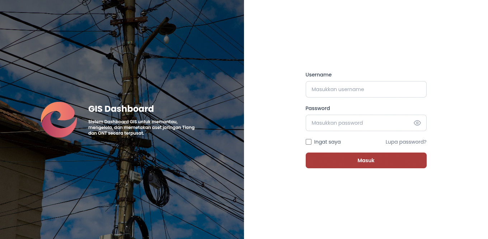
</p>

---

### Home

Halaman Home merupakan halaman utama setelah pengguna berhasil login. Halaman ini menampilkan ringkasan data aset Tiang serta informasi status aset.

<p align="center">
  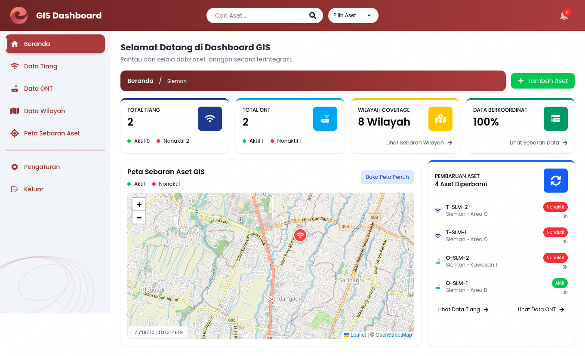
</p>

---

### Data Tiang

Halaman Data Tiang digunakan untuk melihat dan mengelola data aset Tiang yang tersimpan di dalam sistem. Pengguna dapat melihat informasi Tiang, melakukan pencarian atau penyaringan data, serta mengakses detail dan fungsi pengelolaan data.

<p align="center">
  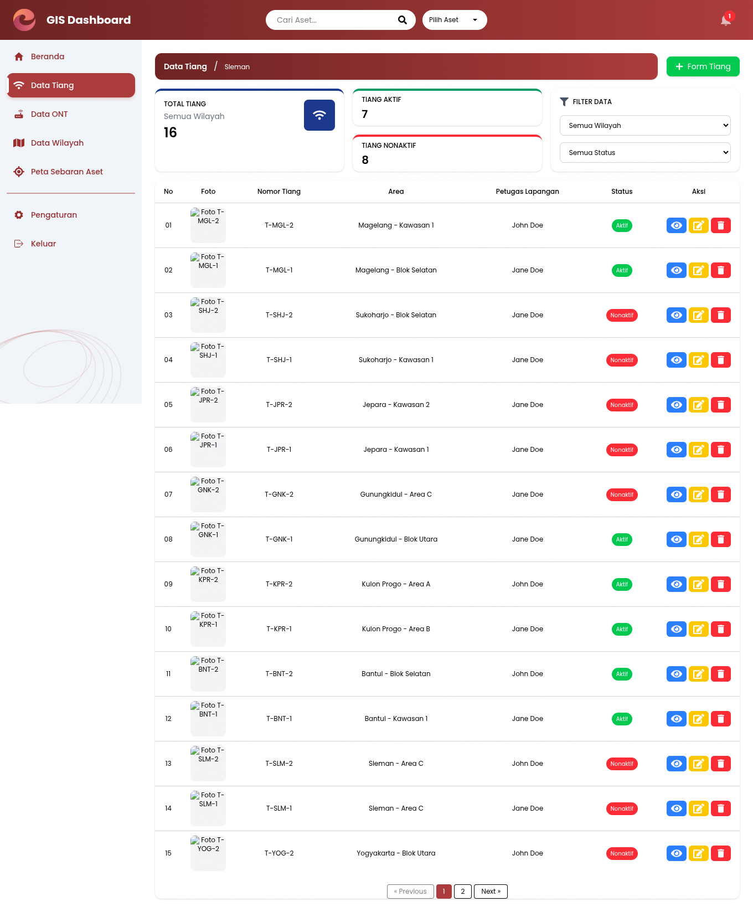
</p>

---

### Data ONT

Halaman Data ONT digunakan untuk menampilkan dan mengelola data perangkat ONT yang terdaftar pada sistem.

<p align="center">
  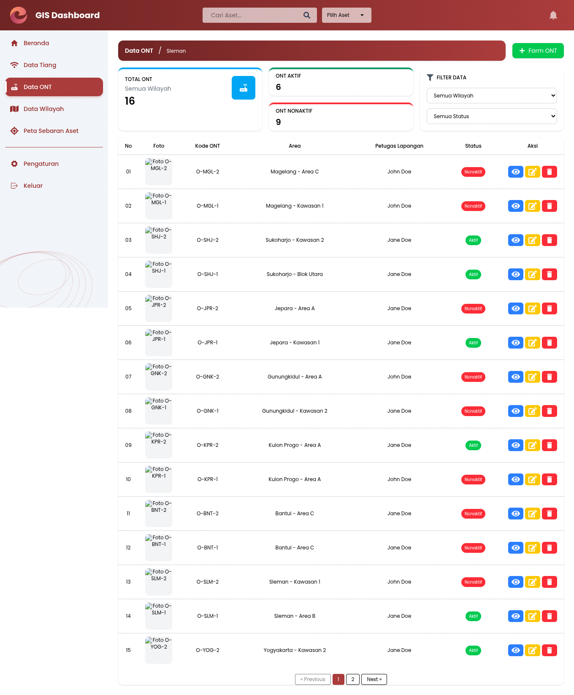
</p>

---

### Data Wilayah

Halaman Data Wilayah digunakan untuk mengelola daftar wilayah yang digunakan sebagai bagian dari pengelompokan dan pengelolaan aset jaringan.

<p align="center">
  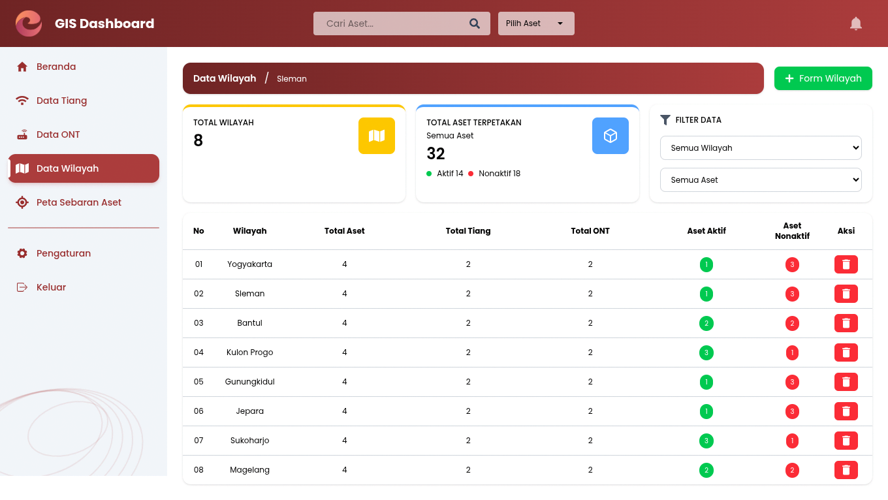
</p>

---

### Peta Sebaran Aset

Halaman Peta Sebaran Aset digunakan untuk menampilkan persebaran aset jaringan secara geografis. Data aset dapat ditampilkan berdasarkan wilayah dan jenis aset sehingga memudahkan pemantauan lokasi Tiang dan ONT.

<p align="center">
  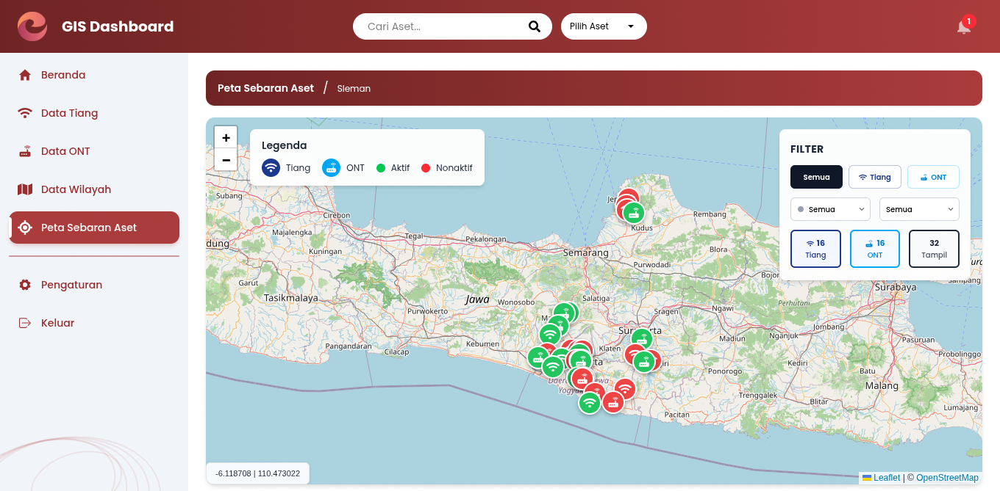
</p>

---

### Form Tambah Tiang

Form Tambah Tiang digunakan untuk memasukkan data aset Tiang baru ke dalam sistem. Form mencakup informasi identitas Tiang, wilayah, area, deskripsi, foto, koordinat lokasi, petugas, serta status aset.

<p align="center">
  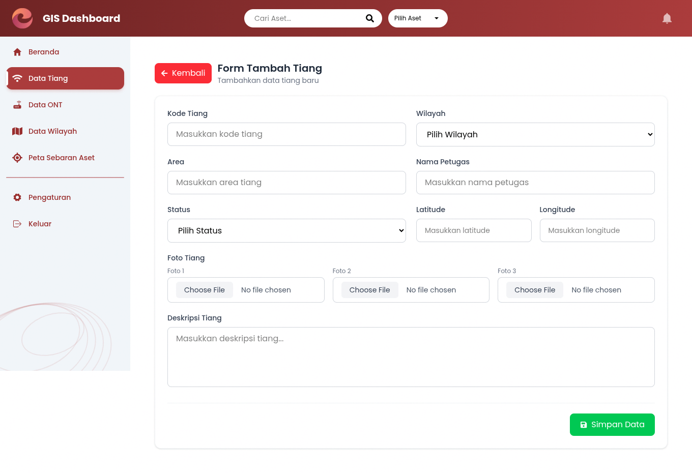
</p>

---

### Edit Tiang

Form Edit Tiang digunakan untuk memperbarui data Tiang yang sudah tersimpan di dalam sistem.

<p align="center">
  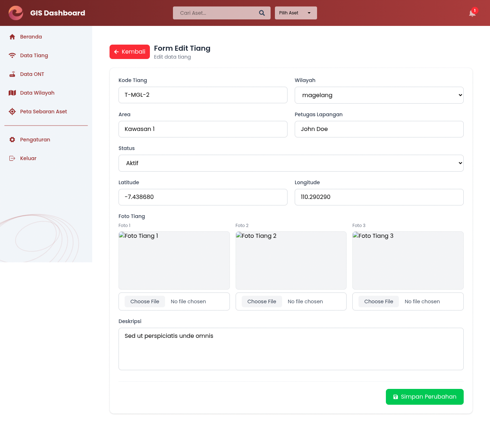
</p>

> **Catatan:** Form Tambah ONT dan Edit ONT memiliki tampilan dan struktur form yang hampir sama dengan form pengelolaan Tiang, dengan penyesuaian field sesuai kebutuhan data ONT.

---

### Form Tambah Wilayah

Form Tambah Wilayah digunakan untuk memasukkan data wilayah baru ke dalam sistem. Form mencakup informasi nama wilayah dan kode wilayah.

<p align="center">
  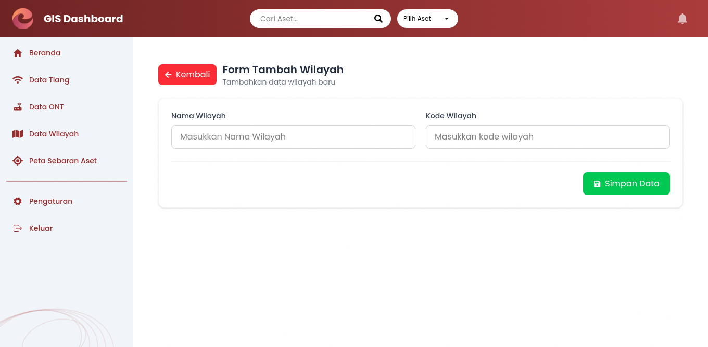
</p>

---

### Notifikasi

Halaman Notifikasi digunakan untuk menampilkan informasi atau pemberitahuan terkait aktivitas dan kondisi data dalam sistem.

<p align="center">
  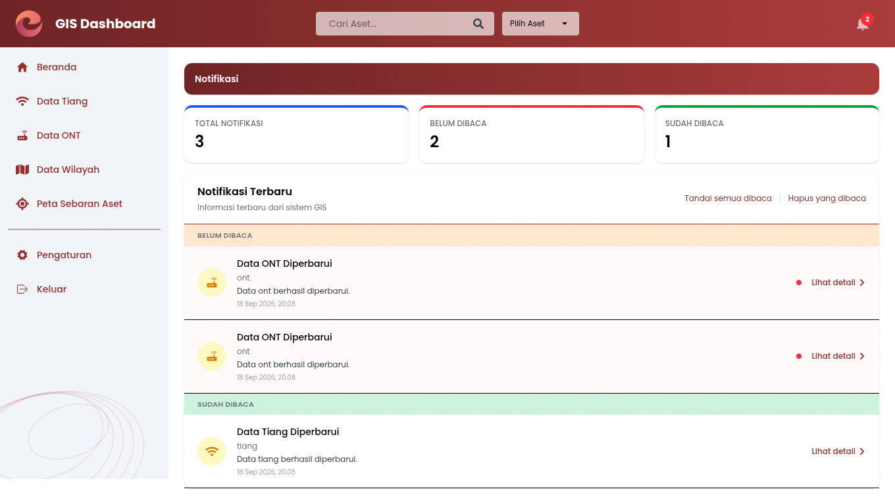
</p>

---

### Detail Notifikasi

Halaman Detail Notifikasi digunakan untuk melihat informasi notifikasi secara lebih lengkap.

<p align="center">
  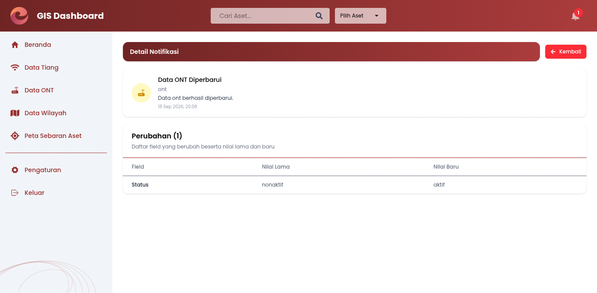
</p>

---

### Pengaturan

Halaman Pengaturan digunakan untuk mengatur konfigurasi yang berkaitan dengan wilayah operasi sistem.

<p align="center">
  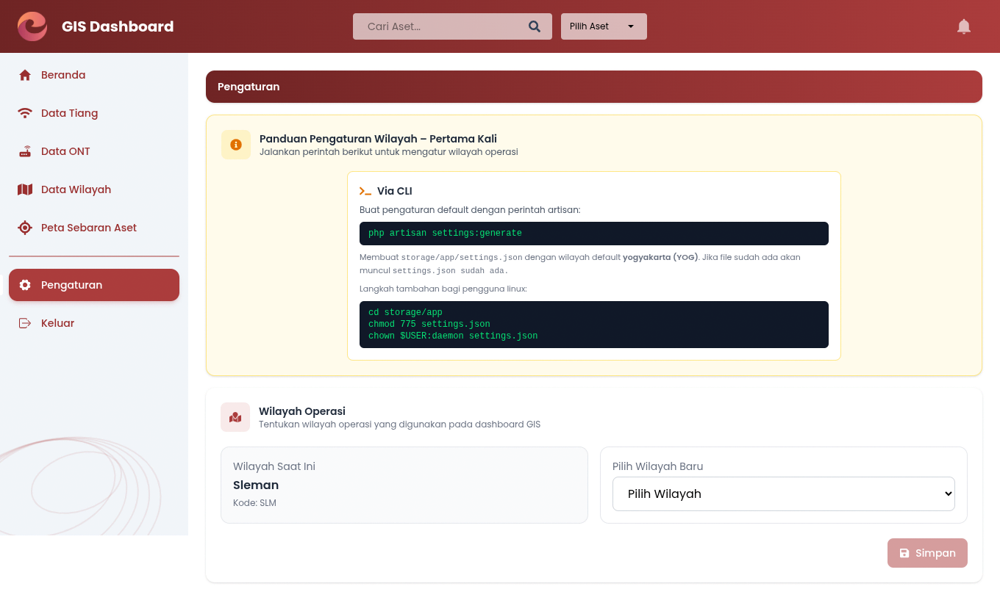
</p>

---

### Lupa Password

Halaman Lupa Password dapat dibuka tanpa login melalui tautan "Lupa password?" di halaman Login. Pengguna mengisi username terdaftar dan kata sandi baru, lalu permintaan menunggu persetujuan admin di kartu **Persetujuan Reset Kata Sandi** pada halaman Pengaturan (atau langsung dari Detail Notifikasi terkait) sebelum berlaku.

---

### Tech Stack
<p align="center">


</p>

### Contributor

Aditya Ammar Al Haqqi (24.02.1095)

Luthfi Fajar Prasetyo (24.02.1108)
